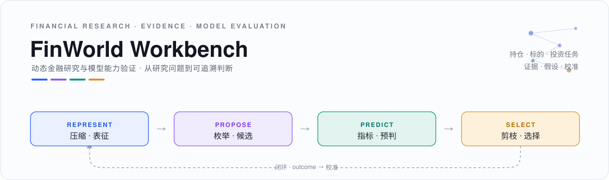
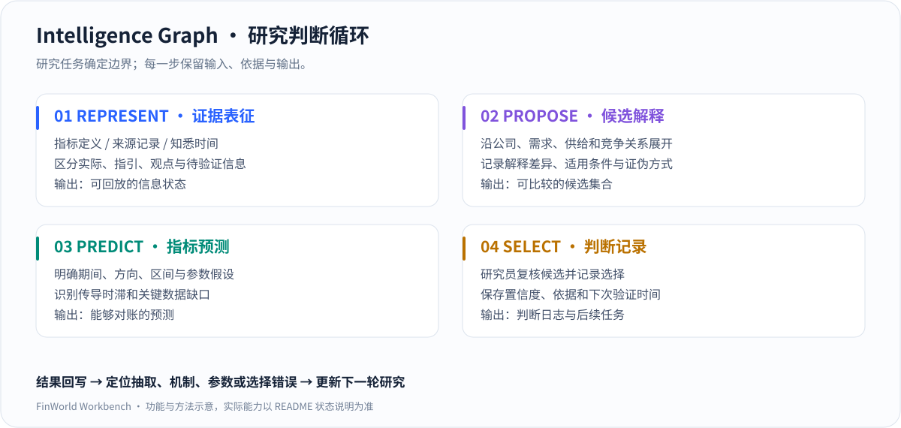
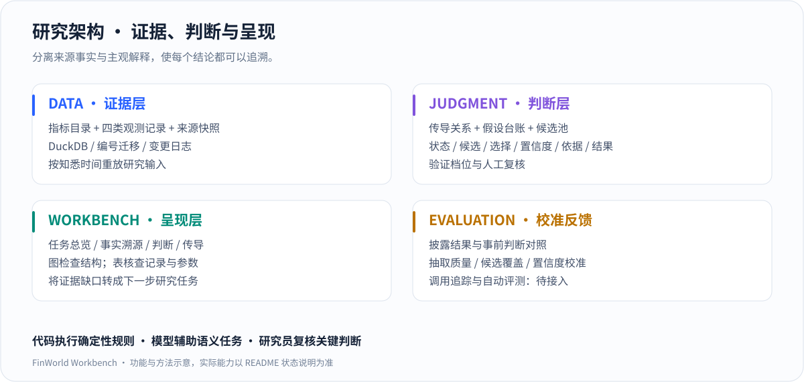
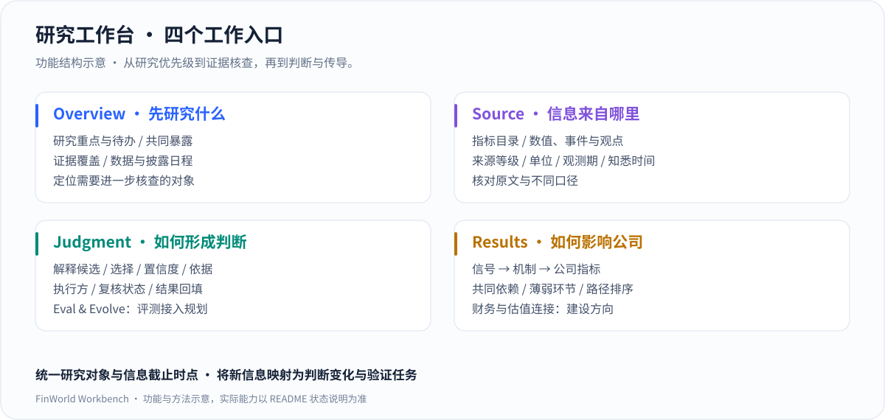

# FinWorld Workbench

**动态金融研究与模型能力验证工作台**

从持仓、研究标的和投资任务出发，把分散的信息组织成可追溯的证据、可检验的假设和可复盘的判断。FinWorld Workbench 关注一条完整的研究链：**发生了什么 → 如何影响公司 → 哪个判断更可信 → 用什么结果验证**。

<p align="center"></p>

<p align="center">


</p>

**能力边界**：仓库提供指标与事实管理、传导关系、假设台账、判断日志、规则校验及研究看板。当前数据覆盖集中于 AI 产业链；跨行业指标扩展、金融数据接口、动态估值和多模型对照属于建设方向。文中的目标流程和概念图不代表所有环节已自动运行。

## 导航

- [一、研究任务与分析范围](#research)
- [二、证据图谱与计算循环](#graph)
- [三、数据、判断与校准](#architecture)
- [四、从经营变量到财务与估值](#financial)
- [五、工作台的研究入口](#workbench)
- [六、模型能力验证与演进](#evaluation)
- [工程入口与运行方式](#engineering)

<a id="research"></a>

## 一、研究任务与分析范围

研究从一个需要回答的问题开始：某项价格变化能否进入利润？新增产能何时兑现为收入？公司的增长依赖行业景气还是份额提升？哪些证据足以支持修正判断？

| 任务入口 | 需要明确的边界 | 研究产出 |
| --- | --- | --- |
| 持仓跟踪 | 持仓日期、投资逻辑、关键假设和证伪条件 | 逻辑变化、共同风险与优先跟踪事项 |
| 标的研究 | 公司、业务分部、可比公司和预测期间 | 业务驱动图、证据缺口与竞争比较 |
| 专项投资任务 | 价格、库存、产能、订单或政策冲击 | 传导路径、影响方向与验证日程 |
| 模型能力验证 | 输入信息、可选判断、评价标准与截止时点 | 判断轨迹、误差归因和能力边界 |

### 统一分析维度

研究对象的指标不同，但应在同一组问题下组织证据。下表是指标扩展的分析规范；当前库中的行业指标不等于已经覆盖所有业务。

| 维度 | 核心问题 | 常见观测变量 |
| --- | --- | --- |
| 成本结构 | 哪些成本随销量变化，哪些成本需要摊薄？ | 材料、代工、良率、折旧、封测和单位成本 |
| 产能弹性 | 供给能多快响应需求，约束在哪里？ | 利用率、扩产周期、设备交付和外包份额 |
| 需求弹性 | 需求来自新增、替换还是补库存？ | 下游销量、渗透率、订单、库存和价格敏感度 |
| 议价能力 | 涨价能否传导，客户能否替换供应商？ | 合同周期、认证成本、客户集中度和产品差异 |
| 竞争情况 | 增长来自市场扩张还是份额变化？ | 份额、竞品定价、产品组合和进入门槛 |
| 供给情况 | 行业新增、退出与渠道库存如何变化？ | 新增产能、停产、交期和渠道库存 |
| 技术迭代 | 技术变化如何改变成本、需求和替代关系？ | 节点、架构、性能、功耗和产品迭代周期 |
| 其他利润因素 | 哪些非经营量价因素改变利润？ | 汇率、费用率、税率、减值与一次性项目 |

### 从信息到研究信号

信息同时按**来源成熟度**和**经济机制**组织。技术研究、供应链反馈与公司披露具有不同的时间尺度，领先期必须逐条论证，不能仅由来源类型决定。

当前 AI 产业链指标按 D1–D7 分类：算力供给、数据供给、资本、人才、算法与能力、商用落地、政策与能源安全。它们是行业指标目录；公司研究还需要本体、需求、竞争与财务视角。

每条信号应指向明确的研究对象，并记录来源、观测期间、知悉时间、更新频率和需要验证的关系。没有可靠数值的变量保留为待补项；定性方向、区间假设和已验证事实分开呈现。

<a id="graph"></a>

## 二、证据图谱与计算循环

Intelligence Graph 将研究拆成指标、事实、传导关系和判断。图中的连线表示需要检验的经济机制；相关性本身不构成因果证据。

| 对象 | 含义 | 仓库中的对应结构 |
| --- | --- | --- |
| 指标 | 定义观察什么、单位是什么、何时更新 | `metric_registry` |
| 事实 | 某个时点从某个来源获得的数值、事件或表述 | `fct_quant` / `fct_event` / `fct_opinion` / `fct_frontier` |
| 传导关系 | 方向、时滞、适用条件和验证档位 | `edge_registry` |
| 假设与系数 | 不能直接观测或尚未充分标定的参数 | `assumption` / `coefficient` |
| 研究判断 | 当时看到了什么、选了什么、依据是什么 | `decision_log` / `candidate_pool` |

### 四步计算与结果回写

1. **REPRESENT · 表征**：将材料转成带来源和知悉时间的标准记录，保留原文依据与不确定性。
2. **PROPOSE · 提出候选**：面对数据背离，列出可区分、可证伪的解释，并记录尚未覆盖的解释空间。
3. **PREDICT · 形成预测**：明确指标、期间、方向或区间，以及假设改变后预测如何变化。
4. **SELECT · 判断与选择**：按证据质量和证伪条件收窄候选，由研究员记录结论、置信度和下一次验证时间。

结果披露后，将实际结果与事前判断对照，分别修正字段抽取、机制假设、参数或选择规则。流程既支持人工研究，也为模型评测提供可回放的任务结构。

<p align="center"></p>

### 信号排序与经济影响分开计算

节点质量包含可靠性 `r`、独家性 `e`、信噪比 `s`、更新频率 `φ` 和固有领先性 `l`；关系层记录传导确定性 `c` 与领先期 `τ`。仓库中的排序表达为：

```text
valuable = w_e·e + w_s·s + w_r·r + w_φ·φ
tradable = c·r·s·φ
warning  = τ·l·e
```

这些表达用于安排研究注意力。`tradable` 是现有字段名，分数不直接代表买卖建议、收益预测或仓位大小。因子标度、时间单位和权重需要登记并校准，不同口径的分数不能直接比较。

经济影响需要另建有单位的关系，例如销量、价格和单位成本如何进入利润；不使用研究排序分数代替财务模型的参数。

<a id="architecture"></a>

## 三、数据、判断与校准

数据层记录证据，判断层记录解释，呈现层将两者连接到研究任务。事实记录也可能有错；溯源、复核和版本管理用于定位并纠正错误。

<p align="center"></p>

### 数据层：可追溯与可重放

- 以 DuckDB 为数据源，使用编号迁移脚本登记增量变更。
- 指标定义与观测记录分离；数值、事件、观点和前沿材料分别入表。
- 记录观测期间与 `knowledge_time`，回放研究时仅使用截止时点前可知的信息。
- 保留来源快照和变更依据，通过 `migration_log` 与 `change_log` 追踪版本。
- 数据纠错保留取代关系，使事前信息与事后修正可以区分。

### 判断层：假设显式化

每条判断保存六类信息：**状态、候选、选择、置信度、依据、结果**。缺少历史置信度的回溯记录不补造置信度，未标定的参数不伪装成事实。

传导证据分为 T1（可回测）、T2（结构与对账）、T3（定性方向）。它们代表不同验证方式；档位不自动等于因果关系成立或预测准确。

### 执行与校准

确定性字段处理与校验交给代码，非结构化材料抽取与候选生成可由模型辅助，研究结论与升档由研究员复核。执行档位按 **Human → Shadow → Assisted → Auto** 管理，是否升档取决于验证结果。

现有规则与日志支持这一治理结构；自动调度、完整模型调用追踪与持续评测仍需接入。使用对象包括研究员、组合经理，以及负责数据质量与模型评测的人员。

<a id="financial"></a>

## 四、从经营变量到财务与估值

工作台的扩展目标是让每个重要判断落到可解释的财务影响上。**以下为建模规范与规划中的连接层，尚不代表仓库已具备完整估值引擎。**

| 层次 | 分析关系 | 必须保留的口径 |
| --- | --- | --- |
| 经营 | 销量、价格、份额、产能、库存和产品结构 | 业务分部、单位、期间、实际值或预测值 |
| 收入 | 各业务销量 × 对应平均售价，再按业务汇总 | 收入确认、币种、产品结构与内部交易 |
| 成本与利润 | 收入减营业成本、期间费用及其他项目 | 固定与变动成本、时滞、税率与非经常项目 |
| 现金流 | 利润经非现金项目、营运资本和投资调整 | 回款、库存、应付、资本开支与融资 |
| 估值 | 用财务预测与明确的方法形成情景区间 | 估值日、折现率或倍数、净债务与股本 |

以单一业务的简化关系为例：

```text
收入 = Q × P
毛利 = Q × (P − C)
```

其中 `Q` 为确认收入对应的销量，`P` 为平均售价，`C` 为与销售匹配的单位营业成本。在销量、成本和产品组合均不变的条件下，`Δ毛利 ≈ Q × ΔP`。若存在需求反馈、成本传导或库存结转，则必须同时调整这些变量。

### 让推断可以被复核

每条关键关系应写清 **影响因素 → 传导机制 → 受影响指标 → 时滞 → 函数或区间 → 证伪条件**。参数须附来源、适用范围与可信程度；无法识别的参数明确留空。

- **情景分析**：围绕需求、供给、价格与成本构造相互一致的假设组合。
- **敏感性分析**：分别识别单变量变化和多变量联动，避免把不能同时成立的极端假设简单叠加。
- **横向比较**：先统一业务结构、会计口径和预测期间，再比较增长、盈利与估值。
- **缺口管理**：区分缺数据、缺函数关系和缺验证样本，逐项定义补充材料与观察时点。

<a id="workbench"></a>

## 五、工作台的研究入口

工作台围绕研究动作组织信息：确定优先级、核查证据、记录判断、分析传导。当前看板可通过[在线研究看板](https://creatoraix.top/AI-Monitoring-System/)访问；页面的数据时点与覆盖范围以具体记录为准。

下图为功能结构示意，表示各入口的职责与联系，不是运行中的实时截图。

<p align="center"></p>

| 入口 | 回答的问题 | 主要内容 |
| --- | --- | --- |
| Overview · 任务总览 | 现在先研究什么？ | 共同暴露、证据覆盖、重点事项和披露日程 |
| Source · 事实溯源 | 这条信息来自哪里？ | 指标目录、逐条观测、来源、单位和知悉时间 |
| Judgment · 判断记录 | 谁基于什么作出了判断？ | 候选解释、依据、置信度、执行方、复核与结果回填 |
| Results · 传导分析 | 信号如何影响研究对象？ | 传导路径、证据结构、共同节点、薄弱环节与排序 |
| Eval & Evolve · 模型评测 | 哪类任务可以由模型稳定承担？ | 评测与升档界面；模型调用与自动评估链路待接入 |

图和表承担不同职责：图用于检查路径结构和共同依赖，表用于逐条核查数值、来源与验证档位。同一来源经多个渠道转述，不能计算成多份独立证据。

当前数据包含 NBIS 等公司的行业研究记录，可用于理解数据结构和回放方法。具体期间、数值和结论应回到源记录核验，不能将案例中的组合权重或历史观察当成当前配置。

<a id="evaluation"></a>

## 六、模型能力验证与演进

模型评测以可复核的研究任务为单位。评价重点既包括答案是否正确，也包括信息是否泄漏、依据是否存在、判断是否可重放。

| 任务 | 检查什么 | 常见失败归因 |
| --- | --- | --- |
| 抽取与分类 | 字段、单位、期间、来源是否正确 | 错读数值、混淆实际与指引、引用不存在 |
| 候选生成 | 是否覆盖关键解释，候选能否区分 | 遗漏机制、重复候选、事后补造解释 |
| 预测与选择 | 预测是否可证伪，置信度是否校准 | 时间错配、参数偏误、过度自信 |
| 工具与工作流 | 调用是否必要，失败能否被发现 | 静默失败、重复处理、成本失控 |
| 研究交付 | 结论能否回溯到证据和假设 | 证据断链、超出数据的推断、未标明未知 |

多模型比较需要固定输入快照、任务定义与评价标准，并记录模型版本、提示、工具、成本和耗时。未来信息不得进入事前任务；结果缺失时保留待验证状态，不将其计为正确。

### 建设路线与验收条件

| 方向 | 当前基础 | 下一步与验收条件 |
| --- | --- | --- |
| 数据覆盖 | 行业指标、事实表、来源与迁移记录 | 扩展业务口径和历史序列；新数据可溯源、可重放 |
| 财务与估值 | 传导关系及假设台账 | 接入经营与财务模型；金额、单位和时滞能够对账 |
| 研究自动化 | 编号脚本、校验与看板生成 | 接入任务调度、失败重试与复核队列；运行状态可观察 |
| 模型评测 | 判断日志、候选池和校准视图 | 接入调用追踪与标注集；按任务检验准确率、成本和校准 |
| 多模型对照 | 统一任务与证据的设计原则 | 同一快照、同一口径比较；差异可归因且可复现 |

<a id="engineering"></a>

## 工程入口与运行方式

| 路径 | 内容 |
| --- | --- |
| [`pipeline/`](pipeline/README.md) | 数据建库、迁移、规则校验和看板生成 |
| [`pipeline/SCHEMA.md`](pipeline/SCHEMA.md) | 表、字段、关系与验证口径 |
| [`data/tables/`](data/tables/) | 初始化导入数据 |
| [`docs/`](docs/) | 数据规范与工程说明 |
| [`research/`](research/) | 研究材料 |
| [`assets/`](assets/) | 图示与看板产物 |
| [`deploy/`](deploy/) | 部署脚本与服务配置 |

在已按 [pipeline 说明](pipeline/README.md)完成初始化和依赖安装的工作副本中，执行增量迁移与校验：

```bash
cd pipeline
python3 migrate.py
python3 checks.py
```

首次建库、完整复现和看板生成步骤见工程文档。数据更新通过迁移记录管理；每次发布前检查来源、时间口径、假设状态及图表与文字的一致性。
